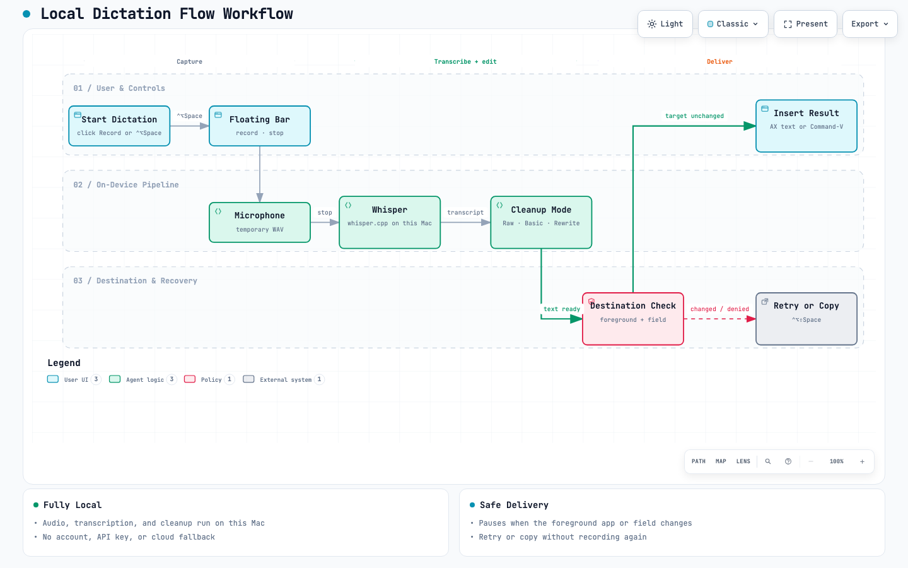

# Local Dictation Flow

This app uses **Reverse Engineer Anything** (**REA**) to analyze **Wispr Flow** and build an original local offline fallback for when **Wispr Flow** is unavailable. No account, API key, word quota, or runtime cloud service.

## Open it without finding the project

Version **0.3** installs as **Applications → Local Dictation Flow**. Press **Command–Space**, type **Local Dictation Flow**, and open it. Launching shows a small floating control bar, not a large settings window. The app also has a Dock icon and a menu-bar entry.


- **Record / Stop**: toggle dictation; the floating bar does not take keyboard focus away from your input field.
- **Gear**: open settings and the transcript.
- **Minus**: hide the floating bar and leave the app running. Open the app again or use the menu-bar **Show / hide floating controls** item to restore it.
- **Power / Command–Q / ◉ Flow → Quit**: quit the app. During processing, quit is deferred until the current local transcription finishes; it will not insert that pending result.
- Drag the bar by its background to move it. Its position is remembered, and it can appear on multiple Spaces and alongside full-screen apps.

Closing the settings window keeps the app running. Reopening the app from Applications or Spotlight restores the floating controls. You may pin its Dock icon manually if desired. No automatic login launch is configured: Wispr Flow remains the default, and Local Dictation Flow is opened when needed as the offline fallback.

## Dictation and insertion

Click your target text field, then click floating **Record** or hold **Control–Option–Space**. Speak, then release the shortcut to stop and transcribe — no second press is needed. The floating **Record** button remains click-to-toggle. The bar shows recording/processing status and the selected destination. Inference is local and may take time.

Microphone access is needed for recording; Accessibility is needed for cross-app insertion. If the new installed version reports missing access, reauthorize **/Applications/Local Dictation Flow.app**, not an old project build. Settings show the actual permission status. These permissions are independent.

The app remembers the last selected external app. Opening settings does not discard that destination; if the dictation app is foreground when processing finishes, it can return to the remembered app before insertion. Switching to a different external app pauses automatic insertion rather than sending text to the wrong place.

To retry a result without recording again, focus its destination and press **Control–Option–Shift–Space**, or use **Insert result in 5 seconds…** in settings and then select the destination field. **Copy result** remains available. No Enter key is generated and no chat message is automatically sent. Recognized terminal apps receive single-line text to avoid submitting a shell command through pasted line breaks.

**Current model:** `ggml-large-v3-turbo.bin`, stored on the internal disk next to the retained `ggml-large-v3.bin`. Local Dictation Flow now selects Turbo; see [model storage and migration verification](docs/model-storage.md). This local configuration differs from the original large-v3 setup performed by the fresh-install script.

Raw mode retains the transcript; Basic conservatively removes fillers; Rewrite additionally uses a local Qwen model. Rewriting can change meaning: review names and numbers. Optional Qwen2.5 7B rewriting uses the local GGUF path configured in settings or `LOCAL_DICTATION_REWRITE_MODEL` in `.env`; that model must be available locally.

## Workflow



[Interactive diagram](docs/dictation-workflow.html) — open the HTML locally for pan, zoom, search, and trace views. It is generated from [`docs/dictation-workflow.json`](docs/dictation-workflow.json).

The happy path is: start dictation, record from the floating bar, transcribe locally with Whisper, apply Raw/Basic/Rewrite cleanup, check the destination, then insert. When Accessibility is missing or the foreground app or field changes, insertion pauses and the result can be retried with **Control–Option–Shift–Space** or copied instead.

## Install, build, and check

```sh
# First checkout only: install whisper.cpp, download multilingual weights.
./scripts/download-model.sh

# Build, keep a stable local speech-model copy, install to Applications.
./scripts/install.sh

# Source / policy regression checks.
./scripts/test.sh
```

The installer makes one checksum-verified copy of the speech model in **~/Library/Application Support/Local Dictation Flow/models/** (about 3.1 GB). The installed app includes its Python worker and icon, so its launcher and default model do not depend on remembering the source folder. It still requires the locally installed whisper.cpp executable; optional rewriting requires llama.cpp and its model. See [runtime resources](docs/resources.md).

Local absolute paths can stay in a gitignored `.env` copied from [`.env.example`](.env.example). Settings values and shell environment variables take precedence over `.env`; never commit `.env`.

For development only, `./scripts/build.sh` creates `build/Local Dictation Flow.app`. Always quit an older copy before opening an updated one; the bundle identifier remains `dev.localflow.desktop` to preserve settings. Recompiling an ad-hoc signed app can require renewing Accessibility authorization. The installer preserves an existing destination as a timestamped backup. It does not download software, add a login item, or replace model files already present in Application Support.

## Verification and limitations

Local microphone transcription, bilingual model inference, and cleanup are verified. Automatic insertion uses the native Accessibility text-field API with a targeted paste fallback. After reauthorizing the current `/Applications` build, the app reported automatic insertion enabled and delivered a test paste. **Perplexity and terminal/TUI insertion are not claimed universally verified**; the floating launcher does not by itself prove or fix all destination compatibility. **Copy result → paste manually** remains available when an app rejects synthetic paste. See [verification details](docs/verification.md).

[Wispr investigation and evidence](docs/investigation.md)

Git stores the app source, scripts, docs, regression tests, synthetic inference result samples, and artifact hashes. Model weights, compiled apps, extracted Wispr code, full REA exports, recordings, and debug logs remain local and are not committed. Automatic startup is not configured. Git remote: `https://github.com/williamjxj/local-dictation-flow.git`.
